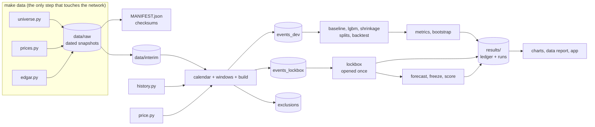

# Architecture

## Modules

| Stage | Module | Output |
|---|---|---|
| Company list | `data/universe.py` | `universe` table |
| Prices | `data/prices.py` | `prices` table (long format, adjusted and raw closes, SPY and ^VIX included) |
| Earnings filings | `data/edgar.py` | `filings` table (8-K Item 2.02 with acceptance timestamps) |
| Trading calendar | `dataset/calendar.py` | NYSE sessions, holidays, early closes |
| Event windows | `dataset/windows.py` | before/after closes per filing, cutoff dates |
| Inputs | `features/history.py`, `features/price.py` | last-8-moves summary, volatility, return, VIX |
| Events table | `dataset/build.py` | `events` and `exclusions` tables |
| Models | `models/baseline.py`, `models/lgbm.py`, `models/shrinkage.py` | predictions |
| Evaluation | `eval/splits.py`, `eval/backtest.py`, `eval/metrics.py`, `eval/bootstrap.py` | runs in `results/` |
| Locked test | `eval/lockbox.py` | single opening of the 2025-2026 test set |
| Live forecasts | `live/forecast.py`, `live/freeze.py`, `live/score.py` | fingerprinted forecast files and scores |
| Reporting | `eval/charts.py`, `eval/data_report.py`, `app/streamlit_app.py` | charts, data report, app |

## Contracts between stages

Every hand-off is a table with fixed columns, defined in `src/btb/schema.py`. Each stage's output must pass `validate(df, "<table>")`.

| Table | Produced by | Consumed by |
|---|---|---|
| `universe` | `data/universe.py` | prices, edgar, build |
| `filings` | `data/edgar.py` | build |
| `prices` | `data/prices.py` | build, live |
| `events` | `dataset/build.py` | models, evaluation, live, app |
| `exclusions` | `dataset/build.py` | data report |
| `predictions` | `eval/backtest.py` | metrics, charts, app |

## Developing without real data

Every module can be developed and tested before real data or its upstream modules exist.

- **Fake events tables.** `btb.synthetic.events("test")` and `measured("test")` load frozen fake datasets with the real columns: `demo` (150 companies), `test` (60) and `null` (60, where the inputs carry no signal beyond history, used by leakage test L4).
- **Fake raw inputs.** `btb.synthetic.raw("tiny")` returns a universe, filings and prices for 20 fake companies with tricky cases planted: an amendment, a duplicate filing, a market-hours filing, a weekend filing, and a company with no prices.
- **A frozen sample run.** `fixtures/demo_results/` holds one complete fake run (ledger, predictions, metrics, forecast drops), so the app and charts can be built before any pipeline step runs.
- **Stand-ins.** Where a module calls another that isn't implemented yet (the build calls the history and price inputs; the live forecast calls the model), tests substitute obviously fake constants via the `standins` fixture. The real function takes over as soon as it exists. Stand-ins only work inside tests, and loading real data refuses to run while they are active.

Unimplemented functions raise `NotImplementedError`. Their tests are reported as skipped, not failed, and `python -m btb.status` lists what remains.

## Rules that keep the result honest

1. `make data` is the only step that downloads. Raw snapshots are never overwritten.
2. Every input uses data up to the Friday cutoff before the report week. Price levels are never inputs, only ratios.
3. `events_lockbox.parquet` is never opened in a notebook. Only `eval/lockbox.py` reads it, once.
4. Every dev backtest writes a ledger row, including the ones that got worse.
5. Model settings in `configs/project.yaml` are locked once the preregistration is tagged.
6. Posted forecasts are never edited. A late drop is void.
